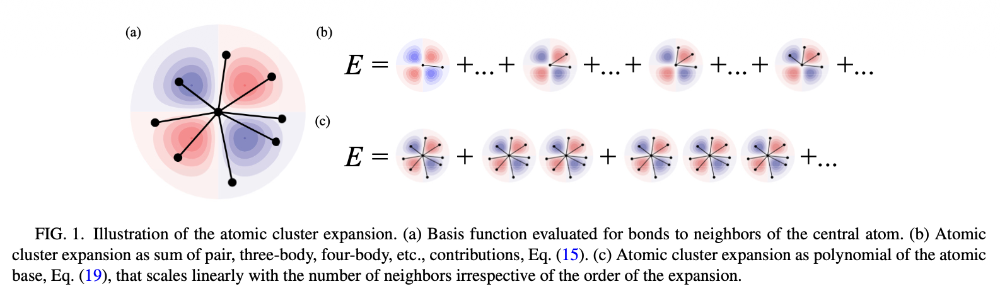

# Atomic Cluster Expansion (ACE)

**Background**

The energy of a system can be assumed  that  the total energy E of the system as a sum of atomic contributions $E_i$
$$
E =	\sum_iE_i
$$
So, it's straightforward to write down the energy of a collection of atoms $i= 1, . . . , N$ in a many-atom expansion:

$$
\begin{aligned}
E =\;& V_0
+ \sum_i V^{(1)}(r_i)
+ \frac{1}{2}\sum_{ij} V^{(2)}(r_i, r_j) \\
&+ \frac{1}{3!}\sum_{ijk} V^{(3)}(r_i, r_j, r_k) \\
&+ \frac{1}{4!}\sum_{ijkl} V^{(4)}(r_i, r_j, r_k, r_l)
+ \cdots
\end{aligned}
$$

$r_i$ is the position of atom $i$ and the potential $V^{(2)}, V^{(3)},...$ are symmetric, uniquely defined, and zero if two or more indices take identical values. Commonly, $V_0$ is a constant offset that can be set to zero and $V^{(1)}$ is the chemical potential

So, the above equation can be written into atomic contributions for each separated energy:

$$
\begin{aligned}
E_i = &\sum_i V^{(1)}(r_i) + \frac{1}{2}\sum_{ij} V^{(2)}(r_i, r_j) \\
&+ \frac{1}{6}\sum_{ijk} V^{(3)}(r_i, r_j, r_k) \\
&+ \frac{1}{24}\sum_{ijkl} V^{(4)}(r_i, r_j, r_k, r_l)
+ \cdots
\end{aligned}
$$

As you can see here, such atomic expansion requires higher order Tylor expansion, the convergence is slow. E,g. Bulk metal potential $V^{(K)}$ up to $K>15$ is required. Even with cutoff that just taking account of nearby atoms within cutoff $r_c$, the evaluation of the leading termof order $K + 1$ in the sum Eq. (3) scales as $N_c^K$, where $N_c$ corresponds to a typical number of neighbors within the cutoff sphere. e.g. for an accurate potentials one requires cutoffs that in a closed packed materials imply $N_c ≈ 10^2 ... 10^3$. It's  challenging to sum expansions within acceptable time.

## ATOMIC CLUSTER EXPANSION

 

We first define the inner product in Hilbert space:
$$
<f|g> = \int f^\star(\sigma)g(\sigma)d\sigma
$$
Next a set of orthogonal and complete basis functions $\phi_v(r)$ with $v = 0,1,2,... $ that depend only on a single bond $r$ are

introduced:
$$
\begin{aligned}
&\int \phi_v(r)^\star\phi_u(r)dr = \delta_{vu}\\
&\sum_v\phi_v(r)^\star\phi_v(r') =\delta(\mathbf{r}-\mathbf{r'})
\end{aligned}
$$
> [!NOTE]
>
> **Proof of completeness**: Set of basis functions $\phi_v$ is capable of describing **any** possible local atomic environment. 
>
> If the basis is complete: $f(r)=\sum_v c_v\phi_v(r)$, where $c_v$ is the coefficient for the basis function
>
> To find a specific coefficient, we project $f(r)$ into the basis, which is the inner product, so, $c_v=\int \phi_v^\star(r^\prime)f(r^\prime)dr^\prime$
>
> The we substitute the $c_v$ obtained by projection to the original formula:
> $f(r)=\sum_v\Big[\int \phi_v^\star(r^\prime)f(r^\prime)dr^\prime\Big]\phi_v(r)=\sum_v\int[\phi_v^\star(r^\prime)\phi_v(r)]f(r^\prime)dr^\prime$
>
> And $\phi_v^\star(r^\prime)\phi_v(r)=\delta(r^\prime-r)$

**Define the cluster expansion**

Here we define the basis functions for the expansion of the atomic energy from the product of single-bond basis functions. By choosing $\phi_0= 1$,  a hierarchical expansion is obtained.

A cluster $\alpha$ with $K$ elements contains $K$ bonds $\alpha = (j_{1i},j_{2i},\ldots , j_{Ki})$, where the order of entries in $\alpha$ does not matter, and the vector $v = (v_1,v_2,. ..,v_K )$ contains the list of single-bond basis functions in the cluster. Only single-bond basis functions with v > 0 are considered in ν. The cluster basis function is given by:
$$
\Phi_{\alpha v} = \phi_{v_1}(r_{j_1i})\phi_{v_2}(r_{j_2i})\ldots\phi_{v_K}(r_{j_Ki})
$$
And the orthogonality and completeness of the one-bond basis functions can be transferred to cluster basis when $0\le K\le N-1$, $\alpha$ is any arbitrary cluster:
$$
\begin{aligned}
\langle \Phi_{\alpha v} \mid \Phi_{\beta \mu} \rangle
&= \delta_{\alpha\beta}\,\delta_{v\mu},\\
1 + \sum_{\gamma \subseteq \alpha}\sum_v
\Phi_{\gamma v}^*(\boldsymbol{\sigma})\,
\Phi_{\gamma v}(\boldsymbol{\sigma}')
&= \delta(\boldsymbol{\sigma}-\boldsymbol{\sigma}').
\end{aligned}
$$
We abbreviate the left hand inner product as a kernel function: $k(\sigma, \sigma')= 1+ \sum_{\gamma\subseteq \alpha}\sum_v \Phi^\star_{\gamma v}(\sigma)\Phi_{\gamma_v}(\sigma'),$ then the expansion of atomic energy can be written as:
$$
E_i(\sigma) =\langle k(\sigma, \sigma')\mid E_i(\sigma')\rangle = J_0+\sum_{\alpha v} J_{\alpha v}\Phi_{\alpha v} (\sigma)
$$
Where the expansion coefficients $J_{\alpha v}$ are obtained by projection:
$$
J_{\alpha v} = \langle \Phi_{\alpha v}(\sigma)\mid E_i(\sigma)\rangle
$$

### Permutation of bonds

If atoms $j$ and $k$ are of the same chemical species then an exchange of the bonds $ji$ and $ki$ leaves the energy or any other

atomic observable unchanged. Which me and a cluster with $K$ bonds contain $k_A, k_B,...$ bonds to bond types $A, B, ...$ , the expansion coefficient $J_{\alpha v}$ should be charaterized by the number of bonds that contains to a specific chemical species: $J_{\alpha v}=J_{k_Ak_B..v}$,  bellow is the application of atomic cluster expansion to elements, for case of the elemental material, one may write $J_{\alpha v}=J_v^{(k)}$
$$
\begin{aligned}
E_i(\sigma)=&\sum_j\sum_v J_v^{(1)}\phi_v(r_{ji})\\ 
&+ \frac{1}{2}\sum_{j_1,j_2}^{j_1\neq j_2}\sum_{v_1,v_2}J_{v_1,v_2}^{(2)}\phi_{v_1}(r_{j_1i})\phi_{v_2}(r_{j_2i})\\
&+\frac{1}{3!}\sum_{j_1,j_2,j_3}^{j_1\neq j_2,...}\sum_{v_1,v_2,v_3}J_{v_1,v_2,v_3}^{(3)}\phi_{v_1}(r_{j_1i})\phi_{v_2}(r_{j_2i})\phi_{v_3}(r_{j_3i})\\
&+\cdots,
\end{aligned}
$$
And the expansion might be rewritten in another way with unrestricted sums and updated expansion coefficients
$$
\begin{aligned}
E_i(\sigma)=&\sum_j\sum_v c_v^{(1)}\phi_v(r_{ji})\\ 
&+ \frac{1}{2}\sum_{j_1,j_2}\sum_{v_1,v_2}c_{v_1,v_2}^{(2)}\phi_{v_1}(r_{j_1i})\phi_{v_2}(r_{j_2i})\\
&+\frac{1}{3!}\sum_{j_1,j_2,j_3}\sum_{v_1,v_2,v_3}c_{v_1,v_2,v_3}^{(3)}\phi_{v_1}(r_{j_1i})\phi_{v_2}(r_{j_2i})\phi_{v_3}(r_{j_3i})\\
&+\cdots,
\end{aligned}
$$
Here we can see we substitute the expansion coefficient of $J_v^{(k)}$ with different coefficient $c_v^{(k)}$. Due to the unrestricted sums products of single-bond basis functions $\phi_{iv}$ that contain the same bonds are obtained. i.e. $\phi_{v_1}(r_{ij})\phi_{v_2}(r_{ij})$ are not part of equation 10 and was excluded as unphysical self-interactions.

**Elimination of self-interactions**

However, with the completeness of the single bond basis functions, these products could be re-expanded at lower order, for example, $\sum_va_v\phi_{v}(r_{ij})=\phi_{v_1}(r_{ij})\phi_{v_2}(r_{ij})$, such that the self-interactions are removed by an appropriate modification of a lower-order expansion coefficient.

> [!NOTE]
>
> Proof:
>
> For a 3 body basis contribution: $\phi_{v_1}(r_{j_1i})\phi_{v_2}(r_{j_2i})$, with $j_1=j_2$, both functions now depend on exactly the same bond, and it only involves 2 distinct atoms. We can easily recover the desired sum via subtracting the repeated part.
> $$
> \begin{aligned}
> \sum_{j\neq k}f(j,k)&=\sum_{j,k}f(j,k)-\sum_j f(j,j),\\
> E_i&=\sum_{j,v}J_v^{(1)}\phi_v(\mathbf r_{ji})\\
> &+\frac12\sum_{j,k}\sum_{v_1,v_2}J_{v_1v_2}^{(2)}\phi_{v_1}(\mathbf r_{ji})\phi_{v_2}(\mathbf r_{ki})\\
> &-\frac12\sum_j\sum_{v_1,v_2}J_{v_1v_2}^{(2)}\phi_{v_1}(\mathbf r_{ji})\phi_{v_2}(\mathbf r_{ji}).
> \end{aligned}
> $$
> And due to the completeness of single bond basis, there products of basis can be also re-expanded by the linear combination of basis. i.e. 
> $$
> \begin{aligned}
> F(r)&=\sum_va_v\phi_{v}(r_{ji})=\phi_{v_1}(r_{ji})\phi_{v_2}(r_{ji})\\
> a& = \int \phi^\star(r') F(r')dr'  = \int \phi^\star(r')\phi_{v_1}(r_{ji}')\phi_{v_2}(r_{ji}')dr'\\
> \end{aligned}
> $$
> Substitute the product expansion into the correction term:
> $$
> -\frac{1}{2}\sum_{j,v_1,v_2}a_{v_1v_2}\phi_v(r_{ji})
> $$
> Since it has the same functional structure with the first order term:
> $$
> c_v^{(1)}=J_v^{(1)}-\frac{1}{2}\sum_{v_1,v_2}J_{v_1v_2}^{(2)}a_{v_1v_2}\\
> c_{v_1,v_2}^{(2)}=J_{v_1,v_2}^{(2)}
> 
> $$
> 

### Atomic base and linear scaling

As argued in background, the summation of many atom potentials quickly becomes numerically prohibitively expensive as it scales as $N_c^k$. While this can be avoided by a simple reordering of summations based on equation 11.

The atomic base is defied as the projection of the basis functions on the atomic density.
$$
A_{iv}=\langle\rho_i|\phi_v\rangle=\sum_j\phi_v(r_{ij})
$$
And the atomic density of an elemental materials is based the Dirac delta:
$$
\rho_i = \sum_j\sigma(\mathbf r - \mathbf r_{ji})
$$
Then the atomic energy in equation 11 becomes a polynomial in $A_{iv}$
$$
E_i(\sigma)=\sum_vc_v^{(1)}A_{iv}+\sum_{v_1,v_2}^{v_1\geq v_2}c_{v_1v_2}^{(2)}A_{iv_1} A_{iv_2} + \sum_{v_1,v_2,v_3}^{v_1\geq v_2\geq v_3} c_{v_1v_2v_3}^{(3)}A_{iv_1} A_{iv_2}A_{iv_3}+ \cdots
$$
Since the computational effort to calculate the atomic basis $A_{iv}$ is linear with the number of neighbors $N_c$ , while the evaluation of the energy in equation 18 is independent of $N_c$, this enables linear scaling with number of neighbors independent of the order of the expansion.

### Basis functions