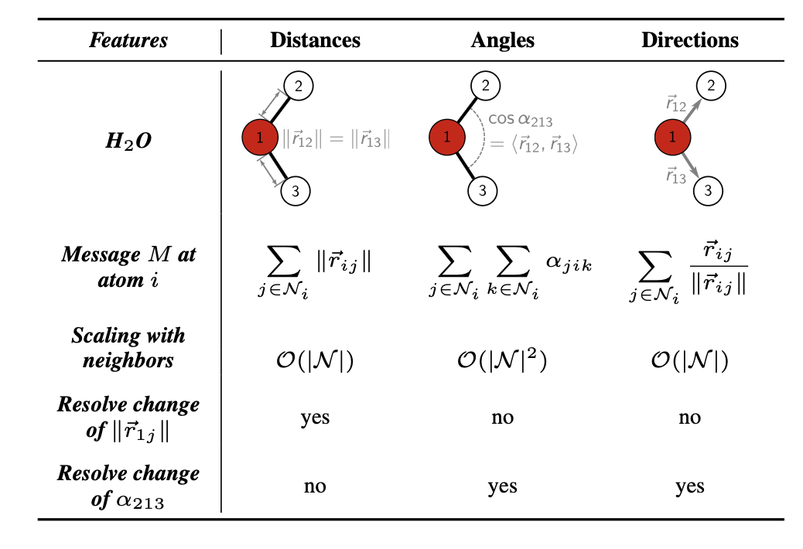
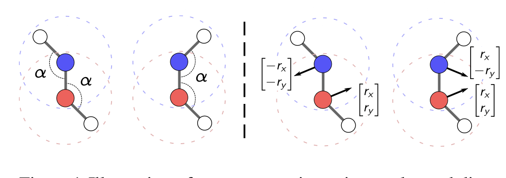
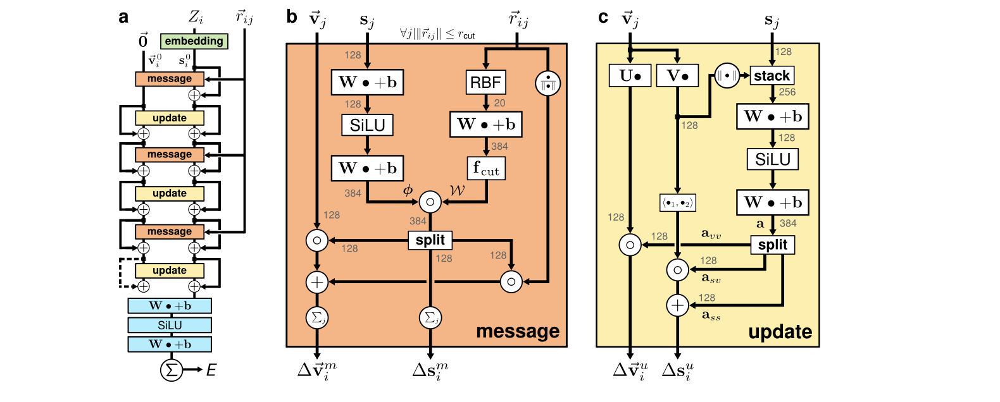

# PAiNN

Compared with schnet, which is an invariant model, neurons only receives the scaler information, while equivariant NN integrates the geometric objects such as vectors (in this work) and tensors.
$$
\vec{m_i}^{v,t+1} = \sum_{j\in\mathcal{N}(i)}\vec{M}_t(s_i^t,s_j^t,\vec{v}_i^t,\vec{v}_j^t)
$$
Where $s$ is the scaler features, while $\vec{v}$ is the vector features

To ensure the equivariance, the message passing function $\vec{M_t}$ and update function $\vec{U_t}$ should fulfilling $R\vec{f}(x)=\vec{f}(Rx)$

### Limits of rotationally invariant representations

Conventional MLIPs ensure rotational invariance of a predicted property, and the message passing function are often restricted invariant features such as distance (schnet), or angles. Although a single message pass is limited to local environments, several message passing can increase the receptive field and propagate the local information beyond the neighborhood. But the central issue is that, where the rotationally invariant representations of atomic environments $h_i$ are sufficient 

As shown above, message passing using angles (right) and directions (left) help us to distinguish the charity.

Unfortunately, including angles in message scales $\mathcal{O}(N^2)$ with number of neighbors. Alternatively, directions to neighboring atoms might be used as messages $\vec{M}_t(\vec{r}_{ij})=\vec{r}_{ij}/|\vec{r}_{ij}|$ and employing the update function $U_t(m)=\|m\|^2$, which is related to angles as:
$$
\left\|\sum_{j=1}^{N}\frac{\vec{r}_{ij}}{\|\vec{r}_{ij}\|}\right\|^2=
\sum_{j,k}\left\langle\frac{\vec{r}_{ij}}{\|\vec{r}_{ij}\|},\frac{\vec{r}_{ik}}{\|\vec{r}_{ik}\|}\right\rangle
=\sum_{j=1}^{N}\sum_{k=1}^{N}\cos\alpha_{jik}
$$
Thus, using equivariant messages, the runtime complexity remains $\mathcal{O}(N)$ while angular information can be resolved.

So, to summary, to maintain the invariance in the representation, the designed message function $\vec{M}_t$ should not only propagate the directions to neighboring atoms, but also the equivariant representation as well.

## Architecture of Painn

### Representation (input)

The inputs to PAINN are the nuclear charges $Z_i \in N$ and positions $\vec{r}_i\in R^3$ for each atom $i$

The they used a residual structure of interchanging the message and update blocks, resulting in coupled scalar and vectorial representations.

For the residual of the **scaler message function**, they adopt the continuous filter same as schnet:
$$
\Delta s_i^m = (\phi_x(s)*W_s)_i = \sum_j\phi_s(s)\circ W_s(\|\vec{r}_{ij}\|)
$$
Analogously, they used the continuous filer convolutions for the residual of the **equivariant message function**:
$$
\Delta \vec{v}_i^m = \sum_j\vec{v}_j\circ \phi_{vv}(s_j)\circ W_{vv}(\|\vec{r}_{ij}\|) + \sum_j\phi_{vs}(s_j)\circ W_{vs}(\|\vec{r}_{ij}\|)\frac{\vec{r}_{ij}}{\|\vec{r}_{ij}\|}
$$
where the first term is a convolution of an invariant filter with scaled, equivariant features $\sum_j\vec{v}_j\circ \phi_{vv}(s_j)$, this propagates the directional information in previous message passes to neighboring atoms. The second term is a convolution of invariant features with equivariant filter. This can be derived as the gradient of an invariant filter:
$$
\nabla W_{vs}(\|\vec{r}_{ij}\|) = W_{vs}'(\|\vec{r}_{ij}\|)\frac{\vec{r}_{ij}}{\|\vec{r}_{ij}\|}
$$

After the features-wise message blocks, the update blocks are applied atomize across features. The residual of the scalar update function is:
$$
\Delta s^u_i= \mathbf{a}_{ss}(s_i, \|\mathbf{V}\vec{v}_i\|) + \mathbf{a}_{sv}(s_i,\|\mathbf{V}\vec{v}_i\|)\langle \mathbf{U}\vec{v}_i,\mathbf{V}\vec{v}_i\rangle
$$

